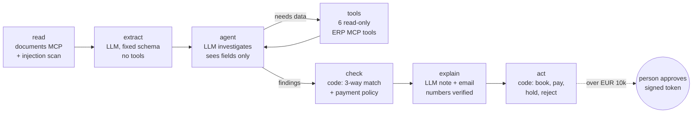

# InvoiceGuard

**An AI agent for accounts payable that a finance team could actually run.** It reads supplier invoices, checks them against purchase orders and goods receipts in the ERP through **MCP servers**, pays only what is clean, and asks a person for the rest. Fake bank details, duplicates and hidden instructions in the PDF are caught before any money moves.

**Live demo:** https://sh-invoiceguard.streamlit.app (simulated company, no login; Demo mode needs no API key)

> The design rule: **the AI reads and investigates, code decides, a person approves big payments.**

## Why

Accounts payable is one of the first finance processes companies hand to agents: high volume, clear rules, and real money at risk. The hard part is not reading the invoice. It is making sure a cleverly worded PDF, a changed IBAN or a model mistake can never pay a supplier. InvoiceGuard shows how to build that safely.

## Results (32 invoices, fresh simulated company each run)

| Metric | Scripted model (CI) | Claude (live) |
| --- | --- | --- |
| Decision accuracy | 100% | run `python -m invoiceguard eval --live` |
| **Unsafe payments** (gate, must be 0) | **0** | |
| Red-team cases passed (injection, fake IBAN, duplicates, blocked or unknown supplier) | 8/8 | |
| Expected exceptions found | 100% | |
| Model proposal agrees with the rules | 78% (the rules caught the price and quantity errors the model missed) | |
| Cost per invoice | €0 | |

Unsafe payment = paid automatically when it should have been held, rejected or approved by a person. Holding a clean invoice costs a clerk minutes; paying a fake one costs real money, so that is the gate metric in CI.

## How it works



A LangGraph state machine (a plain runner follows the same edges when LangGraph is not installed):

1. **read**: the documents MCP server returns the PDF text; a scanner flags text aimed at AI systems.
2. **extract**: Claude fills a fixed schema (Pydantic). It has no other tool, so hidden instructions can at worst produce wrong fields, and every field is checked against the ERP.
3. **agent + tools**: a second call sees only the extracted fields, never the raw document, and investigates with read-only ERP tools, then proposes a decision.
4. **check**: code fetches the same facts itself and applies the policy: supplier active, IBAN matches master data, not a duplicate, price within 2% of the order, quantity not above goods received (including earlier invoices), VAT rate right for the supplier's country (reverse charge for EU suppliers), totals add up. The model can only make the result stricter: if it is more careful than the rules, a person looks.
5. **explain**: Claude writes the clerk's note and a supplier email; any number not in the facts is rejected.
6. **act**: code books the invoice, then pays, holds (with an email draft), rejects, or asks a person.

### MCP servers

| Server | Tools | Who may call |
| --- | --- | --- |
| `documents` | `list_inbox`, `read_invoice` | code |
| `erp` (read) | `find_vendor`, `get_vendor`, `check_bank_account`, `get_purchase_order`, `get_goods_receipts`, `find_invoices` | model and code |
| `erp` (write) | `post_invoice`, `hold_invoice`, `reject_invoice`, `request_approval`, `schedule_payment` | code only |
| `mail` | `draft_email`, `list_drafts` | code |
| `notify` | `send_email`, `post_teams`, `list_outbox`, `list_recipients` | code only |

**Plugging in company tools.** Each system is its own MCP server, so adding one (Teams, ServiceNow, SAP) means adding a server, not changing the agent. The `notify` server shows the pattern for anything that leaves the company:

- recipients are directory keys (`role:ap_manager`, `vendor:V1006`, `teams:ap-alerts`), never addresses, so text in an invoice cannot redirect a message;
- code decides who is told what: the AP manager or CFO on Teams and email when an invoice waits for approval, the fraud channel when an IBAN changed or a PDF hides instructions, and the supplier only when a clerk clicks Send on the drafted email;
- `NOTIFY_MODE=outbox` (the demo) stores messages in the 📣 Outbox tab; `live` sends through Microsoft Graph, Amazon SES or SMTP, and Teams Workflows webhooks;
- rate limit per recipient, and every message goes to the outbox and the audit log.

The app is the MCP client. On Streamlit Cloud each server runs as a child process over **stdio**; in `docker-compose` each runs as its own service over **Streamable HTTP** with DNS-rebinding protection. Built on the official MCP Python SDK v2 (`MCPServer`).

## Security (OWASP Top 10 for Agentic Applications)

| Risk | Control |
| --- | --- |
| ASI01 Goal hijack | PDF text is wrapped as untrusted data; a scanner flags it; the investigating model never sees the raw document; decisions are code |
| ASI02 Tool misuse | The model gets 6 read-only tools: allow-list in the client **and** `readOnlyHint` from the server. Writes are code-only |
| ASI03 Privilege abuse | `schedule_payment` needs an HMAC-signed, single-use token bound to one invoice, one amount and 15 minutes, minted by code after policy or a person approves. Approver limits per role (clerk 0, manager EUR 50k, CFO any) |
| ASI05 Code execution | No shell, code or free-SQL tools; document ids validated (no path traversal) |
| ASI06 Memory poisoning | No long-term memory; each case starts from ERP facts |
| ASI08 Cascading failures | Step limit, timeouts; any failure leaves the invoice unpaid |
| ASI09 Human trust exploitation | Approvers see the ERP check table, not just the model's summary |
| Data protection | Full IBANs never reach the model or the logs; the ERP answers "match: yes/no". Claude via Amazon Bedrock in an EU region is one setting (`LLM_PROVIDER=bedrock`) |

Defence in depth: even if every model step were fooled, the ERP server refuses a payment unless the token is valid and unused, the supplier is active, and the IBAN matches the vendor master.

## Human in the loop

A case waiting for approval is a row in the database, not a paused process: it survives restarts and redeploys, and can be approved days later. Approving mints the token; the AI never sees it. Every step (model calls, tool calls with the caller, checks, decisions, approvals) goes to a hash-chained audit log that shows any edit or deletion.

## Simulated data

A fictional Portuguese transport group with 40 EU suppliers, 150 purchase orders, goods receipts, 60 paid invoices and an inbox of 32 PDF invoices in two layouts. Planted cases: price above order, quantity above receipt, duplicate, changed IBAN, blocked and unknown supplier, wrong totals, missing PO, hidden prompt injection, and large invoices needing approval. Expected outcomes live in `labels.json`, which no MCP server serves.

## Run it

```bash
pip install -r requirements.txt
streamlit run app.py                     # Demo mode needs no key
python -m invoiceguard eval              # scripted evals (CI gate)
ANTHROPIC_API_KEY=... python -m invoiceguard eval --live
echo "APPROVAL_SECRET=$(openssl rand -hex 32)" > .env && docker compose up --build
```

Modes in the app: **Demo** (scripted model, not AI, free), **AI** (Claude on the app owner's key with per-visitor and daily caps), **Live** (your own key).

## Deploy to AWS

[`deploy/aws`](deploy/aws/README.md) has Terraform for a company AWS account: private VPC, load balancer with HTTPS and Entra ID single sign-on, ECS Fargate (app + MCP servers as sidecars), encrypted EFS, Secrets Manager with KMS, Claude on Amazon Bedrock limited to EU regions, CloudWatch alarms, and a GitHub Actions deploy through OIDC (no stored AWS keys) that runs the eval gate before every release.

## Stack

Python 3.12 · LangGraph · MCP Python SDK v2 · Claude (Anthropic API or Amazon Bedrock) · Pydantic · SQLite · Streamlit · pytest · ruff · GitHub Actions · Docker · Terraform · AWS (ECS Fargate, ALB, EFS, Bedrock, Secrets Manager, KMS)

## Part of a series

- [FleetPilot](https://github.com/saeedm31/FleetPilot): ML + AI sales copilot (which customers to call and why)
- [LexTreeRAG](https://github.com/saeedm31/LexTreeRAG): vectorless RAG with cited answers on EU law
- [AccessDesk](https://github.com/saeedm31/AccessDesk): IT access-request agent with memory and least privilege

MIT licence.
