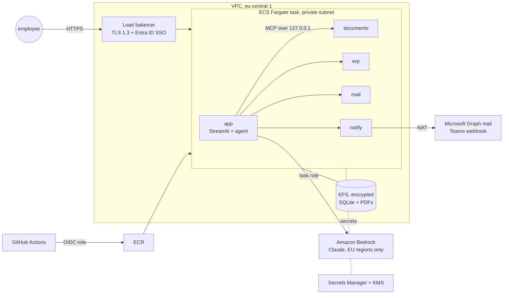

# Deploy InvoiceGuard to AWS

Terraform for running InvoiceGuard inside a company's AWS account: private network, company single sign-on, Claude on Amazon Bedrock in the EU, secrets in Secrets Manager, and deploys from GitHub Actions without stored AWS keys.



## What gets created

| Area | Resources | Why |
| --- | --- | --- |
| Network | VPC, 2 public + 2 private subnets, NAT gateway, S3 gateway endpoint, VPC flow logs, locked default security group | Tasks have no public IP; only the load balancer is reachable; every connection is logged |
| Entry | Application Load Balancer, HTTPS (TLS 1.3 policy), optional OIDC login | Company SSO (Entra ID, Okta) before any request reaches the app; `internal_alb = true` keeps it on the company network |
| Compute | ECS cluster, Fargate service, one task with 6 containers | The app plus the 4 MCP servers as sidecars over Streamable HTTP on localhost, and an init container that prepares the data |
| Data | EFS (KMS-encrypted, TLS-only, access point, daily backup) | SQLite databases and invoice PDFs survive restarts and redeploys |
| Secrets | Secrets Manager (one JSON secret, KMS) | Approval-signing key, optional Anthropic key, Graph client secret, Teams webhook URLs. Never in code, images or Terraform variables |
| AI | Task-role permission for Bedrock, Anthropic models only, EU regions only | No API key; model calls stay in the EU and show up in CloudTrail |
| Images | ECR, immutable tags, scan on push, keep the last 20 | The tag is the commit SHA, so every release can be traced to a commit |
| CI/CD | GitHub OIDC provider and a deploy role limited to one repo, one environment, one service | No AWS keys stored in GitHub |
| Operations | CloudWatch logs (KMS-encrypted, one year), Container Insights, alarms for "app down" and 5xx errors, SNS email, optional load-balancer access logs | You find out before users do, and audits have the trail |

## Deploy in 5 steps

```bash
cd deploy/aws/terraform
cp backend.hcl.example backend.hcl            # S3 bucket for Terraform state
cp terraform.tfvars.example terraform.tfvars  # region, SSO, models, notifications
terraform init -backend-config=backend.hcl
terraform apply                               # about 10 minutes; the service starts with 0 tasks
terraform output github_variables
```

1. In GitHub: **Settings → Environments → New environment `dev`**. Add the values from `github_variables` as environment variables (and `APP_URL` for the smoke test). For `prod`, add required reviewers so a person approves every production deploy.
2. **Actions → deploy-aws → Run workflow.** It runs the tests and the eval gate, builds the image, pushes it to ECR with the commit SHA as the tag, registers a task definition, rolls out, and waits until the service is healthy. A failed release is rolled back automatically.
3. Optional: fill the secret named in `terraform output secret_name` (Graph client secret, Teams webhook URLs) and set `notify_mode = "live"` to really send emails and Teams cards.

Check it: `terraform fmt`, `validate` and a Checkov security scan run in the `terraform` workflow on every change to this folder. Where a Checkov rule is skipped on purpose (WAF, TLS between the load balancer and the task, secret rotation), the reason is written next to the resource as a `#checkov:skip` comment.

## Choices and trade-offs

- **Sidecars, not separate services.** The 4 MCP servers are small, so one task keeps it simple and cheap, and the traffic stays on localhost. When a server is shared by several agents (for example one `erp` server for finance and procurement agents), move it to its own ECS service behind Service Connect; the app only changes its `MCP_URLS`.
- **One task and SQLite on EFS.** Right for a department and a demo, and a deploy stops the old task before starting the new one (a short downtime). For several tasks and zero-downtime deploys: cases and the audit log go to RDS PostgreSQL, invoice PDFs to S3, and new invoices arrive through S3 events + SQS to a worker service.
- **Bedrock instead of an API key.** Access is the task's IAM role, limited to Anthropic models in EU regions. Set `bedrock_model_ids` to the model or inference-profile ids enabled in your account. For the Anthropic API instead: `llm_provider = "anthropic"` and put the key in the secret.
- **Who approves.** The ALB adds the signed-in user to each request (`x-amzn-oidc-data`). The next step is to read it in the app and map Entra ID groups to the approver roles, instead of the demo's "Acting as" selector.
- **Notifications.** The notify server holds the only outbound credentials. Graph uses an app registration with `Mail.Send` scoped in Exchange Online so it can send only as one mailbox; Teams uses a Workflows webhook per channel.

## Rough cost (eu-central-1, one task always on)

Around 100–120 USD per month: Fargate (1 vCPU, 2 GB) about 40, NAT gateway about 35 plus data, load balancer about 20, and a few dollars for EFS, KMS, Secrets Manager and logs. Bedrock is pay per token. Check the AWS Pricing Calculator for your region. `terraform destroy` removes it all (in prod, turn off the load balancer's deletion protection first).
