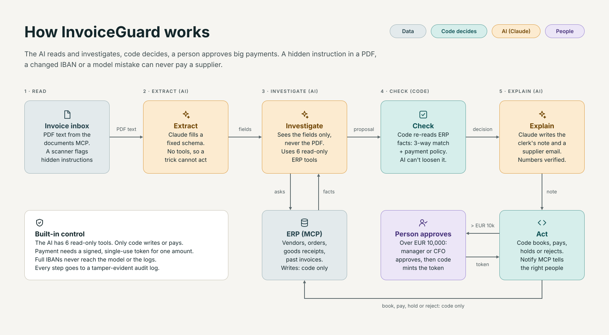
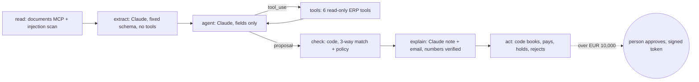

# Architecture

## The rule behind the design

**The AI reads and investigates, code decides, a person approves big payments.** Every step that moves money or
changes the ERP is plain code. The model's output can only make an outcome stricter, never looser.

## The workflow graph

| Step | Who | What happens | Why it is safe |
|---|---|---|---|
| read | code | the documents MCP server returns the PDF text; a scanner flags text aimed at AI systems | the scan only adds a flag; it never clears one |
| extract | Claude | fills a fixed Pydantic schema from the text | no tools, so a hidden instruction can at most produce wrong fields, and every field is compared with the ERP |
| agent | Claude | investigates with read-only ERP tools and proposes a decision | sees only the extracted fields, never the raw document; step limit `MAX_AGENT_STEPS` |
| check | code | re-reads the facts from the ERP and applies the payment policy | same invoice, same decision, every time |
| explain | Claude | writes the clerk's note and a supplier email | any number not in the facts is rejected |
| act | code | books the invoice, then pays, holds (with an email draft), rejects, or asks a person | payment needs a signed, single-use token |

A plain runner in `agent/graph.py` follows the same edges when LangGraph is not installed.

## Payment policy (`checks.py`)

Supplier known and active · IBAN matches the vendor master · not a duplicate · price within 2% of the order
(`PRICE_TOLERANCE`) · quantity not above goods received, counting earlier invoices · VAT right for the supplier's
country (reverse charge for EU suppliers) · totals add up. Above EUR 10,000 (`APPROVAL_LIMIT_EUR`) a person must
approve. Approver limits: clerk 0, AP manager EUR 50,000, CFO any amount.

## MCP servers

| Server | Tools | Who may call |
|---|---|---|
| `documents` | `list_inbox`, `read_invoice` | code |
| `erp` (read) | `find_vendor`, `get_vendor`, `check_bank_account`, `get_purchase_order`, `get_goods_receipts`, `find_invoices` | model and code |
| `erp` (write) | `post_invoice`, `hold_invoice`, `reject_invoice`, `request_approval`, `schedule_payment` | code only |
| `mail` | `draft_email`, `list_drafts` | code |
| `notify` | `send_email`, `post_teams`, `list_outbox`, `list_recipients` | code only |

The model's tool list is an allow-list in the client, and the server marks read tools with `readOnlyHint`. The ERP
server refuses a payment unless the token is valid and unused, the supplier is active and the IBAN matches, so even a
fooled client cannot pay.

## Approval token

Approving mints an HMAC-signed token bound to one invoice, one amount and 15 minutes (`TOKEN_TTL_S`). It can be used
once. The model never sees it. A case waiting for approval is a database row, so it survives restarts and can be
approved days later.

## Where it runs

| Piece | Local | Docker compose | Public demo (Streamlit Cloud) | Company setup (AWS) |
|---|---|---|---|---|
| App | `streamlit run app.py` | `app` service | Streamlit Cloud | ECS Fargate behind a load balancer with Entra ID single sign-on |
| MCP servers | stdio child processes | 4 services over Streamable HTTP | stdio child processes | sidecar containers in the same task |
| ERP, cases, audit log | SQLite files | shared volume | SQLite files (reset on restart) | encrypted EFS |
| Claude | API key or scripted demo model | API key | shared key with spend caps, or demo mode | Amazon Bedrock, EU regions only |
| Secrets | `.env` | `.env` (`APPROVAL_SECRET`) | Streamlit secrets | Secrets Manager with KMS |
| Messages | outbox tab | outbox | outbox | Microsoft Graph or SES, Teams webhooks (`NOTIFY_MODE=live`) |
| Deploy | - | - | push to `main` | GitHub Actions with OIDC, eval gate before every release |

Terraform and the guide: [deploy/aws](../deploy/aws/README.md).

## Audit log

Model calls, tool calls (with the caller), checks, decisions, approvals and messages go to `audit.db`. Each row holds
the hash of the row before, so an edited or deleted row breaks the chain.

More: [data card](data_card.md) · [evaluation](evaluation.md) · [decision records](adr/)
